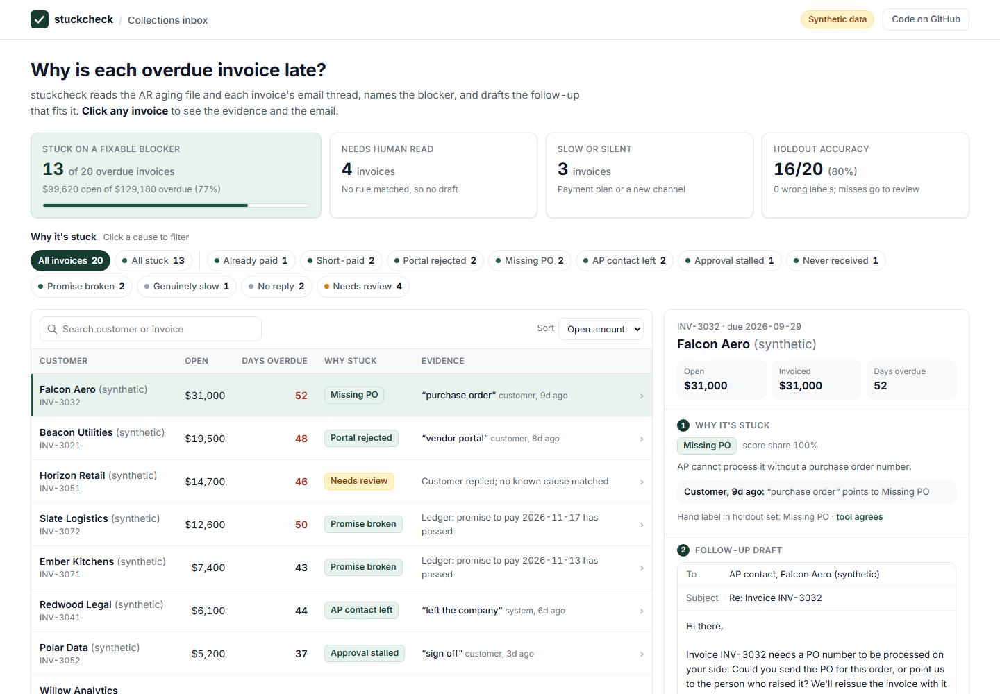
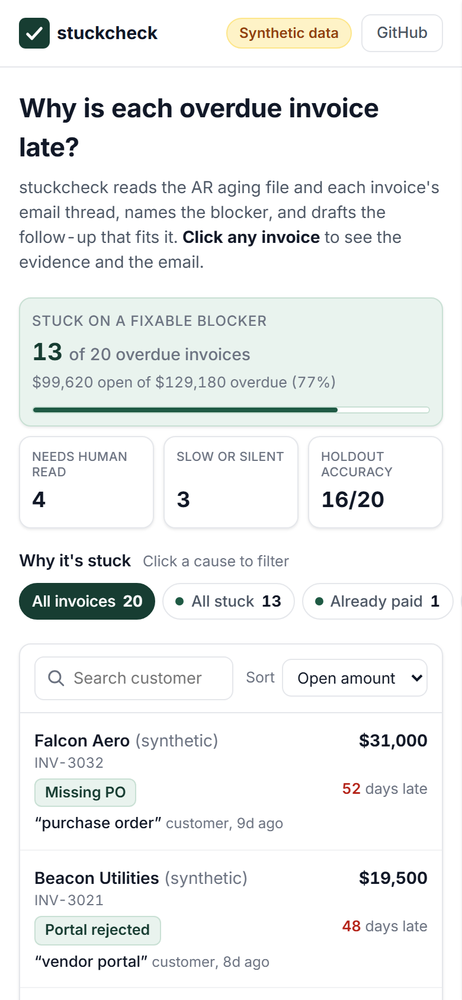
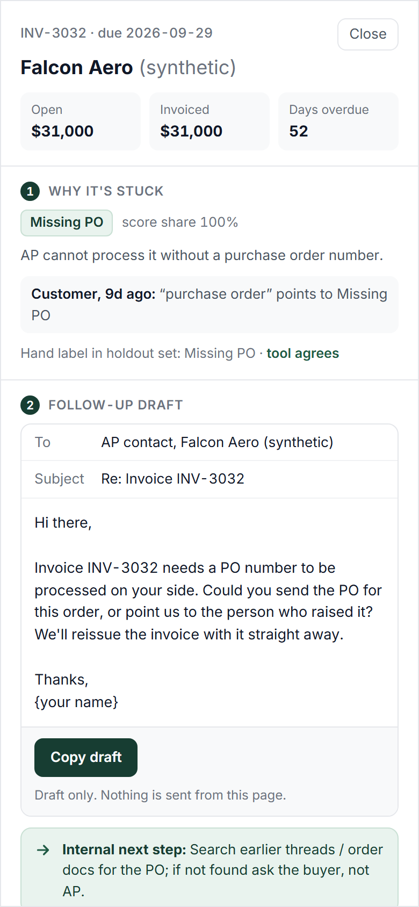

# stuckcheck: why is this invoice late?

**[Try it live: stuckcheck-ar.vercel.app](https://stuckcheck-ar.vercel.app)** (no install, synthetic data)

[](https://stuckcheck-ar.vercel.app)

**Problem:** dunning tools send the same reminder to every overdue customer, whether they already paid, need a PO, or had the invoice rejected by a portal.

**Result:** on 20 synthetic overdue invoices, stuckcheck found 13 stuck on a fixable blocker ($99,620 of $129,180 open), sent 4 it could not explain to a human instead of guessing, and drafted a different follow-up for each cause. Holdout accuracy 16/20, with 0 wrong confident labels.

 

A small, offline, rules-based tool that reads an AR aging export plus each invoice's email thread,
labels every overdue invoice with a likely **cause**, and drafts a **cause-specific** follow-up
(plus an internal next step). Built as a proof of work for Alder (meetalder.com, formerly Nivara, YC F25).

## The problem (from Alder's own public pages)

Source: https://meetalder.com/collections (read 20 Nov 2026)

> "Reminders on a schedule don't collect cash."
> "The same email for everyone. Generic dunning goes out whether the customer is disputing, waiting on a PO, or has already paid."
> "Sorts each balance. Genuinely slow, stuck, disputed, or never received. Each gets a different next step instead of the same reminder."

Source: https://meetalder.com/ (read 20 Nov 2026)

> "Late invoices aren't refusals. They're stuck."

The homepage then lists six stuck reasons: the approval stalled, the AP portal rejected it, the PO
number is missing, the AP contact left, it was short-paid, the promised payment never came.

So the question this repo answers is: given only what a finance team already has (the aging file and
the email thread), can a simple, auditable system tell *why* each invoice is late before writing
anything?

## What was built

- `stuckcheck/classifier.py`: scores 10 causes from ledger fields (partial payment, bounced contact,
  promise date passed) and regex cues in **customer** replies only (newest reply weighted 2x). Returns
  label, a score share, and the evidence lines that fired. If a customer replied but nothing matched,
  it returns `needs_review` instead of guessing.
- Causes: `already_paid`, `short_paid`, `portal_rejected`, `missing_po`, `contact_left`,
  `approval_stalled`, `never_received`, `promise_broken` (first eight map to the reasons on Alder's
  pages above), plus `genuinely_slow` (cash-flow / payment plan) and `no_reply` (we chased, silence).
- `stuckcheck/drafter.py`: one template per cause. Each asks for the one thing that unblocks payment
  (remittance, PO, approver name, new AP contact...) and gives an internal next step. Drafts only.
- `stuckcheck/cli.py`: runs on `data/demo_aging.csv` + `data/demo_threads.json`, prints a triage
  table and a headline, writes all drafts to `out/followups.md`.
- `stuckcheck/evaluate.py`: accuracy on labelled sets.

The demo page in `site/` is plain HTML/CSS/JS; it reads `site/data.json`, which `scripts/export_site_data.py`
generates from the real classifier + drafter output. Deploy: `cd site && vercel --prod`.

Python 3.12, standard library only. No network calls, no LLM. Tests use pytest.

## How to run

```
python -m stuckcheck.evaluate                 # accuracy on dev + holdout
python -m stuckcheck.cli data/demo_aging.csv data/demo_threads.json
python -m pytest -q
python scripts/build_demo.py                  # rebuilds the demo CSV/threads from the holdout set
python scripts/export_site_data.py            # writes site/data.json for the live demo page
```

## Results (actual output, 20 Nov 2026)

```
data/dev_set.json: 30/30 correct = 100%
data/holdout_set.json: 16/20 correct = 80%
   miss INV-3002: gold=already_paid     pred=needs_review
   miss INV-3051: gold=approval_stalled pred=needs_review
   miss INV-3061: gold=never_received   pred=needs_review
   miss INV-3081: gold=genuinely_slow   pred=needs_review
```

`pytest`: 20 passed.

How to read these numbers:
- The **dev set** (30 cases, 3 per cause) was written alongside the rules, so 100% there only means
  the rules cover what I wrote. It is not a real accuracy figure.
- The **holdout set** (20 cases, 2 per cause) was written *before* the rules were first run, with
  different phrasing, and the cue lists were **not** changed after seeing its result. 80% is the more
  honest number.
- All 4 holdout misses went to `needs_review` (route to a human), none to a wrong confident label.
  They are phrasings the regexes do not know: "settled ... with our batch transfer", "hasn't approved
  it yet", "First I'm hearing of this one", "pay this over three months". This is exactly where an
  LLM classifier would beat rules.

Demo headline from the CLI on the 20 holdout invoices: `13/20 overdue invoices look STUCK (a fixable
blocker), $99,620 open.`

## Using it in a sales demo (technical GTM angle)

1. Ask a prospect's AR lead for an anonymised aging export plus last reply per invoice (or use this
   synthetic set).
2. Run the CLI live: the table shows that most "overdue" is really "stuck", with the reason and the
   evidence line next to each invoice.
3. Open `out/followups.md`: same customer, different emails depending on cause, versus one generic
   dunning template. That contrast is the pitch from Alder's collections page, shown on their data.
4. The `needs_review` rows are a natural hand-off: "rules catch the obvious ones, Alder's agent reads
   and calls on the rest".

It can also be turned into outbound content (e.g. a "why your invoices are late" checker on a
landing page) since it needs no API keys.

## Honest limits

- **All data is synthetic**, written by me. Customer names carry "(synthetic)". No real customer,
  invoice or personal data was used.
- 50 hand-written cases is tiny; real AR threads are longer, messier, multilingual and often mix
  causes (e.g. a portal rejection *because of* a missing PO). The classifier returns one label.
- "Confidence" is just the top cause's share of total score, not a calibrated probability.
- Regex cues are English-only and brittle to new phrasing (see holdout misses).
- No portal access, no calls, no ERP or bank-feed integration. Alder's product does those (per its
  site); this repo only does the "diagnose then draft" step on text.
- Drafts are never sent. A human should read every draft.
- This is not Alder's code or method; it is my own small take on the problem their pages describe.
